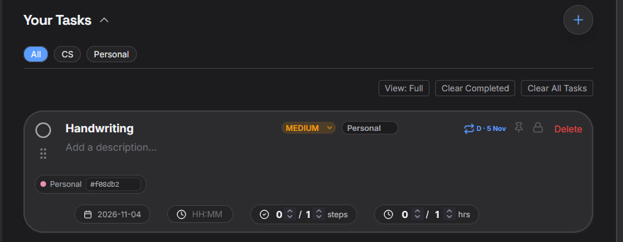
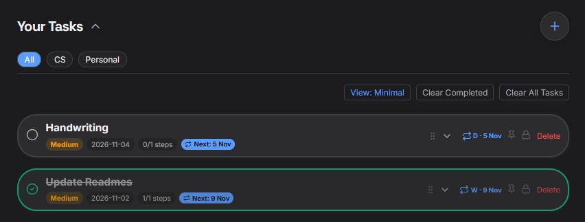
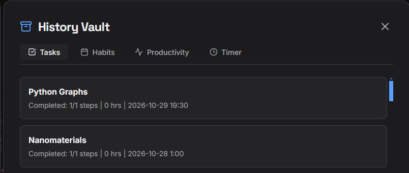
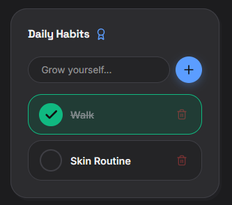
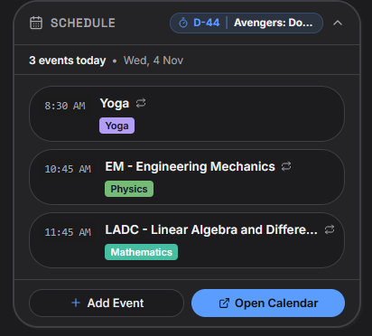
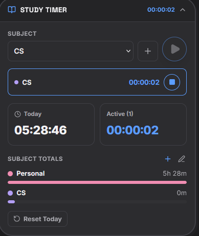
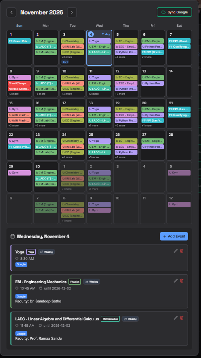
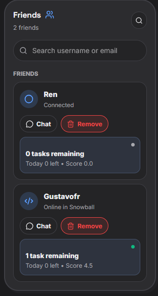
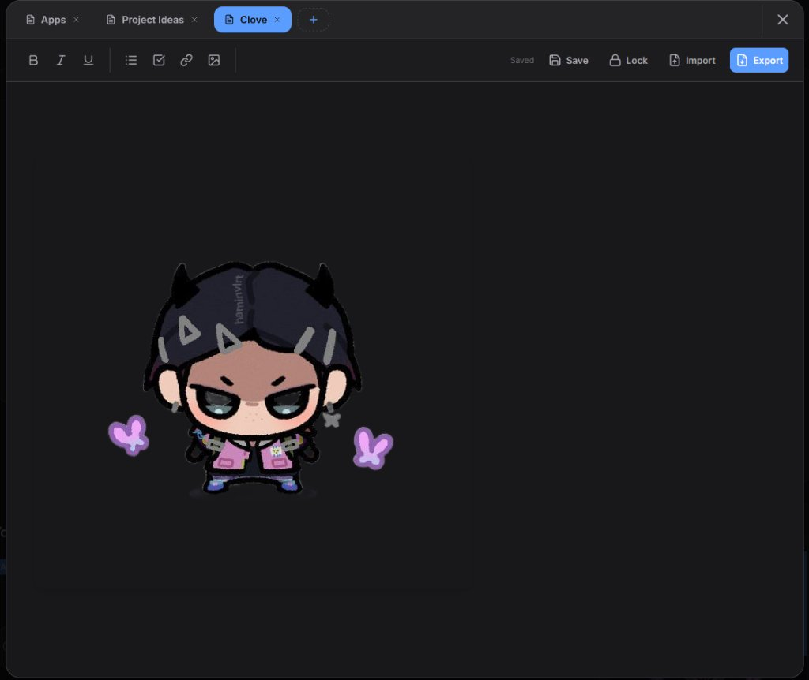
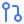

<div align="center">
  
  <h1>Snowball</h1>
  <p><b>A local-first productivity hub for staying consistent — without the app-switching fatigue.</b></p>
  <p>
    <a href="https://github.com/Horrid-12/Snowball/releases"></a>
    <a href="./LICENSE"></a>
    <a href="https://github.com/Horrid-12/Snowball/actions/workflows/codeql.yml"></a>
    
    
    
  </p>
  <p>
    <a href="#features">Features</a> ·
    <a href="#architecture">Architecture</a> ·
    <a href="#preview">Preview</a> ·
    <a href="#get-started">Get started</a> ·
    <a href="#installation">Installation</a> ·
    <a href="#status">Status</a> ·
    <a href="#license">License</a>
  </p>
</div>

Snowball replaces the daily juggle of a task manager, habit tracker, focus timer, calendar, and notes app with a single system — one source of truth for your routine on **Windows, macOS, Linux, Android, and the web**. Everything is stored locally first and synced to the cloud in the background, so the app stays fast and keeps working offline.

---

##  Features

###  Task Management

- **Planning & execution**: priorities, due dates, and scheduled times for your day.
- **Progress tracking**: completion counts and effort allocation per task.
- **Tagging**: custom, color-coded tags for effortless categorization.

###  Habit Tracking

- **Consistency first**: a dedicated tracker for daily habits.
- **Visual momentum**: an activity heatmap that tracks your consistency over months.

###  Deep Work & Focus

- **Focus timer**: a built-in timer to cut out distractions and enter a flow state.
- **Session tracking**: completed sessions are logged to the study heatmap and history view.

###  Calendar & Scheduling

- **Month view**: single-day, multi-day, and recurring events (daily, weekly, monthly, yearly — with optional end dates).
- **Google Calendar**: connect from inside the app, pick which upcoming events to import (reviewing and retagging each one), or import the whole batch with shared settings. Recurring Google series keep their rules.
- **Alerts that stay in-app**: get notified when a new event appears on your Google Calendar, and see a summary of upcoming events that aren't in Snowball yet.

###  Knowledge & Scratchpad

- **Quick notes**: a low-friction scratchpad for reminders, ideas, and temporary logs.
- **Zero overhead**: fast access to information without maintaining a full wiki.

###  Media Hub

- **Spotify & YouTube**: bring study/work soundtracks and tutorials straight into your focus environment.
- **Only what you use**: the Spotify card appears once you've connected an account and disappears when you disconnect; YouTube has its own independent toggle, so one can live without the other.

###  Personalization

- **Dashboard cards**: show or hide any of the nine dashboard cards (timer, stats, calendar, tasks, heatmap, Spotify, YouTube, notes, habits) from **Settings → Dashboard Cards**. Changes apply immediately and sync across signed-in devices.
- **Tags that follow your theme**: alongside per-tag colors, a "Follow theme" mode derives every tag color from the active accent so the palette shifts with your theme. Custom per-tag colors are paused, not deleted, and come back when you turn it off.

##  Architecture

Snowball is built on a **local-first** philosophy: immediate responsiveness and offline availability come before constant network connectivity. For a deeper dive, see [ARCHITECTURE.md](./ARCHITECTURE.md).


[](https://gitdiagram.com/horrid-12/snowball?utm_source=readme&utm_medium=picture)

###  Sync Engine

- **Immediate UI (optimistic updates)**: every mutation is applied to local state and IndexedDB (via Dexie.js) instantly.
- **Eventually consistent**: changes are pushed to the cloud (Supabase) in the background.
- **The outbox pattern**: if a network request fails, the mutation is stored in a local `outbox` queue and replayed automatically when connectivity is restored.

### Tech Stack

| Layer            | Stack                                                                                                                                                                                                                                                                                                                                                                                                              |
| ---------------- | ------------------------------------------------------------------------------------------------------------------------------------------------------------------------------------------------------------------------------------------------------------------------------------------------------------------------------------------------------------------------------------------------------------------ |
| Frontend         |      |
| Local storage    |                                                                                                                                                                                                                                                                                                                                         |
| Backend          |                                                                                                                                                            |
| Database & auth  |                                                                                                                                                                                                                                |
| Desktop & mobile |                                                                                                                                                                                                                  |
| Hosting          |                                                                                                                                                                                                                                                                                                                                   |

##  Preview

A tour of the current interface — click any image to open it at full size.

**Plan and review**

<p align="center">
  <a href="./docs/assets/screenshots/Tasks_Full.PNG"></a>
  <br><sub>Full task board — priorities, dates, tags, and effort tracking</sub>
</p>

<p align="center">
  <a href="./docs/assets/screenshots/Tasks_Minimal.PNG"></a>
  <br><sub>Minimal task board</sub>
</p>

<p align="center">
  <a href="./docs/assets/screenshots/History.PNG"></a>
  <br><sub>History and productivity score</sub>
</p>

**Track and focus**

| Habits | Daily summary | Focus timer |
|:---:|:---:|:---:|
| <a href="./docs/assets/screenshots/Habits.PNG"></a> | <a href="./docs/assets/screenshots/Calendar_Summary.PNG"></a> | <a href="./docs/assets/screenshots/Timer.PNG"></a> |

**Organize and connect**

| Calendar | Friends | Quick notes |
|:---:|:---:|:---:|
| <a href="./docs/assets/screenshots/Calendar.PNG"></a> | <a href="./docs/assets/screenshots/Friends.PNG"></a> | <a href="./docs/assets/screenshots/Expanded_Notes.PNG"></a> |

##  Get Started

Run the app from source. Prerequisites: [Node.js](https://nodejs.org/) 22+ and git.

```bash
git clone https://github.com/Horrid-12/Snowball.git
cd Snowball
npm run install:all
cp backend/.env.example backend/.env
npm run dev
```

<details>
<summary>Windows PowerShell users</summary>

```powershell
git clone https://github.com/Horrid-12/Snowball.git
cd Snowball
npm run install:all
Copy-Item backend\.env.example backend\.env
npm run dev
```

</details>

Before the backend can start, fill in `backend/.env`. Start from [backend/.env.example](./backend/.env.example), which documents each supported variable:

| Variable | Required | Purpose |
| -------- | -------- | ------- |
| `JWT_SECRET` | yes | Signs auth tokens — any long random string is fine in development |
| `SUPABASE_URL` | yes | Your Supabase project URL |
| `SUPABASE_SERVICE_ROLE_KEY` | yes | Server-side service role key — never expose it to clients |
| `SUPABASE_ANON_KEY` | yes | Anon key used for RLS-scoped, user-token queries |
| `FRONTEND_URL` | no | Frontend origin for CORS and OAuth redirects (local defaults work in development) |
| `GOOGLE_CLIENT_ID` / `GOOGLE_CLIENT_SECRET` | no | Google Calendar connect and import |
| `SPOTIFY_CLIENT_ID` / `SPOTIFY_CLIENT_SECRET` / `SPOTIFY_REDIRECT_URI` | no | Spotify tab in the Media Hub |
| `YOUTUBE_API_KEY` | no | YouTube playlist import (search works without it) |

`VITE_DISCORD_CLIENT_ID` is a **frontend** build-time setting, not a backend one: it enables Discord Rich Presence in the desktop build and is not a sign-in credential. Set it in `frontend/.env` if you want to override the default already baked into `frontend/src/config.js`.

The app then runs at:

- Frontend: [http://127.0.0.1:5173](http://127.0.0.1:5173)
- Backend: [http://localhost:3000](http://localhost:3000)

##  Installation

Download a prebuilt app from [Releases](https://github.com/Horrid-12/Snowball/releases):

| Platform | Download Artifact | Installation / Running |
| -------- | ----------------- | ---------------------- |
| **Windows** | `Snowball_*_x64-setup.exe` | Run the installer and launch Snowball from the Start Menu. |
| **macOS (Apple Silicon)** | `Snowball_*_aarch64.dmg` | Open the `.dmg`, drag `Snowball.app` into **Applications**. *(See Gatekeeper note below.)* |
| **macOS (Intel)** | `Snowball_*_x64.dmg` | Open the `.dmg`, drag `Snowball.app` into **Applications**. *(See Gatekeeper note below.)* |
| **Linux (Ubuntu/Debian)** | `Snowball_*_amd64.deb` | Run `sudo apt install ./Snowball_*_amd64.deb` (or double-click to install). |
| **Linux (Universal)** | `Snowball_*_amd64.AppImage` | Run `chmod +x Snowball_*.AppImage`, then `./Snowball_*.AppImage`. |
| **Android** | `Snowball_*.apk` | Sideload and install the APK on your device. |

> [!NOTE]
> **macOS first launch (Gatekeeper):** Because Snowball is community open-source and not signed with an Apple Developer ID certificate ($99/yr), macOS will flag the app on first launch. To run it:
>
> 1. Right-click (or Control-click) `Snowball.app` in `/Applications` and select **Open**.
> 2. Click **Open** in the confirmation dialog.
> 3. *Alternative:* Go to **System Settings → Privacy & Security**, scroll down to Security, and click **Open Anyway** (or run `xattr -cr /Applications/Snowball.app` in Terminal).

##  Status

**Current stage: active development.** Features are added and refined frequently. Contributions and feedback are welcome — see [Issues](https://github.com/Horrid-12/Snowball/issues) for current bugs and feature requests.

##  Contributing

Contributions, bug reports, and feature requests are all welcome:

1. Fork the repository and create a feature branch.
2. Make your changes — see [Get Started](#get-started) to run the app locally.
3. Open a pull request describing what changed and why.

Report bugs and propose features in [Issues](https://github.com/Horrid-12/Snowball/issues). For security matters, follow [SECURITY.md](./SECURITY.md).

##  License

Distributed under the MIT License. See [`LICENSE`](./LICENSE) for details.
